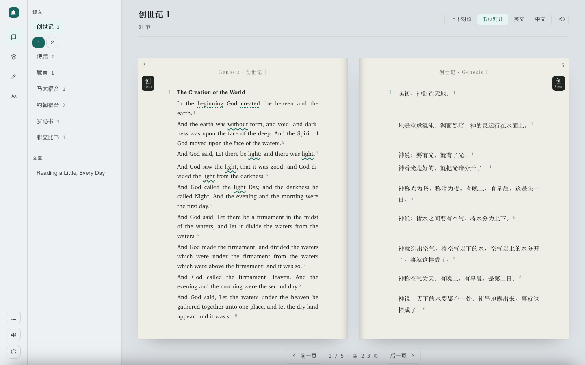

# 圣经英语学习工具箱 · 交互原型

一套可直接点开就用的 HTML 原型。四个模块（阅读 / 词库 / 练习 / 英语基础）齐全且可切换，数据是合成的演示数据。

```
05-sidebar-rail-grot-text/
  index.html      页面骨架
  styles.css      全部样式
  app.js          全部脚本
  设计说明.md      这一套怎么来的、怎么用（独立于原型，不出现在界面上）
```

用浏览器直接打开 `design/05-sidebar-rail-grot-text/index.html` 即可，不需要构建、不需要服务器。



## 这一套是什么样

| 底色 | 强调色 | 版式 | 字体 | 圆角 / 行距 / 行宽 |
| --- | --- | --- | --- | --- |
| 石板日 `#dde2e6` | 深青 `hsl(176 59% 25%)` | 图标轨 + 内容台 | grotesque + 书籍衬线 | 11 / 1.70 / 72ch |

交互按 Apple 的方法做：底部资料面板用弹簧与动量投影，1:1 跟手拖动，橡皮筋边界，速度交接；系统字体优先，尊重 `prefers-reduced-motion` 与 `prefers-reduced-transparency`。

## 种子怎么决定长相

原型先由脚本生成一段 96 位的随机字母数字串，再由这段串派生出一整套参数：

1. 串做 blake2b 摘要，得到 48 字节的确定性摘要。
2. 摘要按不同偏移切成若干段，每段决定一个维度：底色、强调色相、版式、字体、密度、圆角、行宽、描边风格、动效。
3. 强调色相先归一到 0–360°，再检查是否落在"一眼模板"的两个区间（8–32° 与 340–352°），落在就整体旋转 148° 推到冷色一侧。
4. 明度按底色反推，直到前景/背景对比度达到 4.5:1 以上。
5. 摘要不同的偏移还用来保证候选之间底色、版式、字体不重复，强调色相彼此至少差 26°。

字符本身的统计量（大小写比例、数字比例、最长连续段）只用来挑密度档位，不直接决定颜色。

生成脚本在 `design/_seed/seed.py`，产物在 `design/_seed/seeds.json`。脚本一次派生 5 个互不撞车的候选（横向比较需要同时看全部候选），最后只留了第 5 个，`seeds.json` 里也只写了这一个。**种子串本身不会出现在任何界面上。**

## 页面骨架

```
.shell
├─ .bar[data-bar]              品牌 / 模块导航 / 工具
└─ .frame
   ├─ .side[data-side]          目录、筛选、材料来源
   └─ .main[data-main]
      ├─ .pane[data-pane=read]
      ├─ .pane[data-pane=bank]
      ├─ .pane[data-pane=practice]
      ├─ .pane[data-pane=basics]
      └─ .detail[data-detail]    词条详情 / 章节跳转 / 练习小结
```

外加浮动的 `.lookup`（查词浮层）和 `.toast`（提示条）。

`<body>` 上还有一个 `data-reader-mode`（当前阅读视图）。书页对开这一版靠它切换版式：正文容器变成两页网格，节号从左侧编号列改成句末的上标小号，版式层再给正文让出宽度。

## 各模块的行为

**阅读**：四种视图切换——**上下对照**（英中上下排）、**书页对开**（仿真实对开本的排版）、**英文**、**中文**；进度记在本地；点单词查词，划词也能查；每一章右下角列出本章出现的收藏词，可以直接跳去练习。

**书页对开**这一版按印刷对开本的样子做：

- 一摊就是两页：左页英文、右页中文，中间一道装订阴影；每页一个窄栏（约 18 个汉字或 10 个英文单词一行），两侧留白宽。
- 页面家具照搬真书：书眉压在版心正中（左页用「Genesis · 创世记 2」，右页用「创世记 · Genesis 2」）；页码在版心外侧的上角；外侧空白处一枚深色圆角书口标记（「创」下压「Gen」）；页脚是脚注区，英文页放英文注、中文页放中文注。
- 正文细节：节号是句末的小号上标；每节段落的编号以大号数字挂在文字栏左边；每节开头，英文页印一行该节的标题（"Adam and Eve" 一类），中文页不印；英文两端对齐并允许断词，中文用宋体横排、字距略松；和合本「神」前的空格保留。
- 翻页有两条路：底部的「前一页 / 后一页」，以及键盘 ← →。页码是按"卷、章、对开"推出来的（创世记第一章是第 2–3 页），和真书一样从卷首开始编。
- 整章排不下时按行高自动摊页，脚注跟着它提到的那一节走，所以脚注永远落在该出现的那一页。

和真本子故意不同的两处：真本子的中英两栏各自流排、中文常常比英文多走大半页；这里左右两页同一行是同一节，为的是能逐节对读。左右也反了——真本子左页先见中文，这里左页先见英文，跟多数人读英文对照本的顺序一致。窄屏（版心放不下两页时）自动改成一页一栏、英文在上中文在下，仍按节对齐。

**词库**：按阶段（全部 / 生词 / 学习中 / 已掌握 / 错词）筛选，按词或释义搜索，可手动添加；点开一个词看音标、词性、释义，以及四组关系——**词形变化**（同一个词的不同形式）、**派生关系**（由它造出的新词）、**词源**（这个词的来路）、**常见搭配**。这三类关系分开标注，不会把同源词混成一堆。

**练习**：单词四种（跟打、默写、听写、自测），句子与经文三种（跟打、逐句默写、填空）。逐字符标色，错误位置留在原地不自动跳过；默写和听写不显示答案，按 Tab 偷看；错词自动进错词本。本轮结束给一份纯列表小结，不做速度排行榜。

**英语基础**：音标（点一下读例词）、语法句法（每条配例句和出处）、词根与词族（三类关系画在一张图上）、基础词汇短语。这一块独立可用，不依赖先读过任何东西。

## 数据说明

界面里出现的经文是公有领域的文本：英文取 1611 年钦定版（KJV），中文取和合本；词条、语法条目、音标与例词是为演示合成的，不代表某个词典的正式数据。顶栏右侧的清空按钮会恢复成初始演示状态。

每章的数据放在 `design/_build/js/00-chapters-*.js` 里（创世记、诗篇箴言、马太福音约翰福音、罗马书腓立比书各一份），一章一段：经文、和合本译文、十节段落的分段编号、该节的小标题、章节脚注。文件缺失时构建会用占位数据兜底，不会构建失败。

十节段落的编号是按和合本的分段走的（创世记第一章一节，第四章起每节再分），英文页的小标题另给。脚注按 "1:26 …" 这种带节号的写法挂回对应的经文。

## 重新生成

```bash
python3 design/_seed/seed.py      # 重新生成种子与参数（写回第 5 个候选）
python3 design/_build/build.py    # 由 design/_build/ 下的模板生成原型
```

构建源文件：

```
design/_build/
├─ build.py             读 seeds.json，套模板，产出 05-sidebar-rail-grot-text/
├─ shell.html           页面骨架模板
├─ css/base.css         共用的组件层
├─ css/layout-sidebar-rail.css   这一套的布局层
├─ js/00-data.js … 06-boot.js   共用的应用逻辑
├─ js/00-chapters-*.js  各卷经文数据（经文 / 译文 / 分段 / 脚注）
├─ js/07-apple.js       苹果式动效层（弹簧、动量投影、橡皮筋、速度交接）
├─ cdp.js               用无头 Chrome 截图 / 跑脚本
└─ tests/*.js           交给 cdp.js 执行的检查脚本（书页、查词、词根、冒烟…）
```
